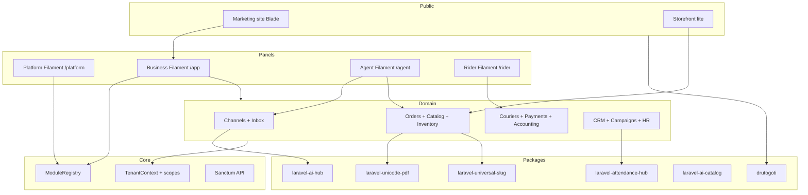

# ARCHITECTURE

## Tenancy

- `businesses` are tenants; `branches` are optional sub-scopes.
- Tenant models use `BelongsToBusiness` / `BelongsToBranch` traits.
- `SetTenantContext` middleware sets context from the authenticated user.

## Module system

- Manifests in `app/Modules/*/module.json`.
- Runtime enablement via `business_modules`.
- Module Center page for owners; Platform panel manages tenants/plans/CMS.

## Integration adapters

Interfaces under `app/Core/Contracts`:

- `ChannelAdapterInterface` → Mock Meta / WhatsApp
- `CourierAdapterInterface` → Mock Steadfast / Pathao
- `PaymentGatewayManager` → COD/manual live; other gateways stubbed

## Events / queues

Queue driver defaults to `database`. Slow work (AI, PDF, courier sync) should be dispatched as jobs; demo paths also run synchronously for simplicity.
