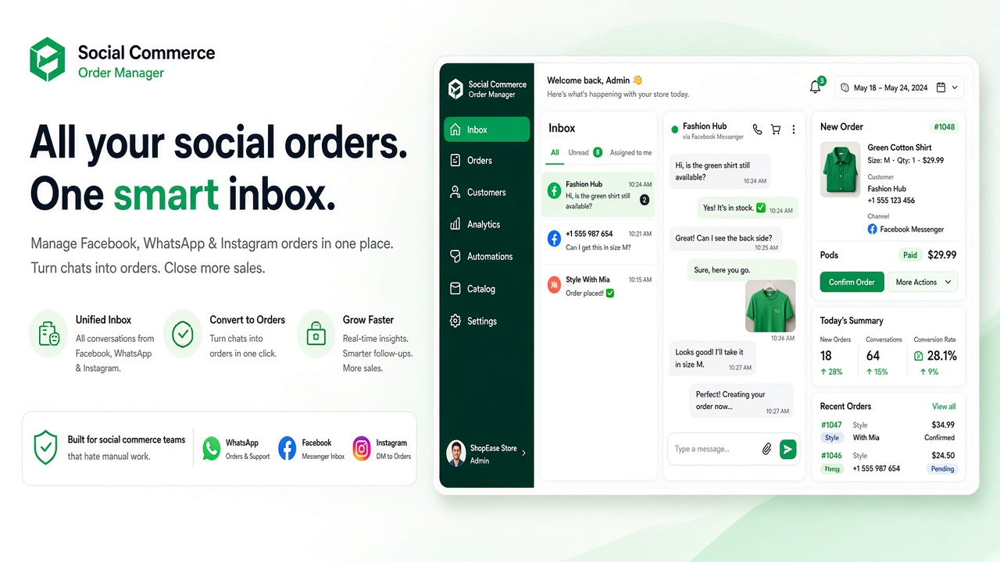
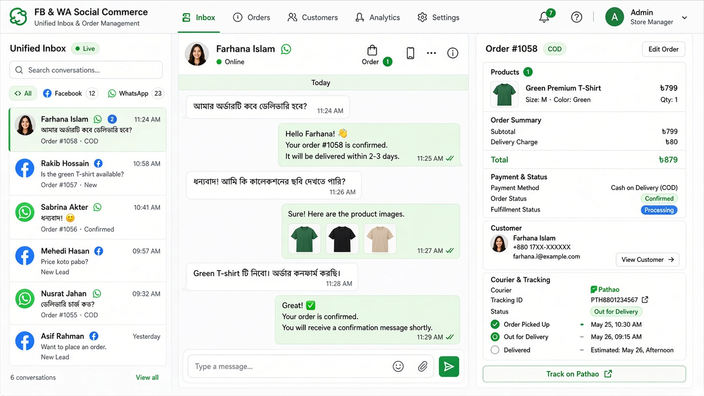

# Social Commerce Order Manager — Facebook / WhatsApp Orders

### From Chat Message → Confirmed Order → Packed → Shipped → Paid → Accounted

<p align="center">
  
</p>

<p align="center">
  <strong>The operating system for Facebook, Instagram & WhatsApp sellers.</strong><br>
  Capture messy chats, extract orders with AI, fulfill with inventory + courier, collect COD, and close the books — modular per business.
</p>

<p align="center">
  <a href="https://imrandev.bd">Portfolio</a> ·
  <a href="https://packagist.org/packages/imrandevbd/">Packages</a> ·
  <a href="mailto:me@imrandev.bd">me@imrandev.bd</a>
</p>

---

## The problem (and the money)

Social sellers in Bangladesh and emerging markets close sales in Messenger / WhatsApp / Instagram DMs. Orders live in screenshots, voice notes, and Banglish text. Spreadsheets break. Couriers get wrong addresses. COD reconciliation becomes a monthly nightmare.

**Social Commerce Order Manager** is a complete multi-tenant business suite that turns that chaos into a productized SaaS — sell plans by module (Inbox, AI Capture, Courier, Accounting, HR…).

### Opportunities for founders & agencies

| Opportunity | Outcome |
| :--- | :--- |
| **Vertical SaaS** | Launch “Facebook Order OS” for fashion, gadgets, food, cosmetics presets |
| **Per-module pricing** | Customers pay only for Inbox + Orders first; upsell Accounting / HR later |
| **AI credit packs** | Bangla/English order extraction becomes metered revenue |
| **Courier marketplace** | Abstract Steadfast / Pathao / RedX — become the control plane |
| **White-label agency** | Agencies run many shops under one installation |
| **Demo-led PLG** | `/live-demo` + channel simulator closes deals without Meta app review first |

### Time saved for a busy shop (estimate)

| Pain today | With this platform | Est. savings |
| :--- | :--- | :--- |
| Typing orders from chat into Excel (30–90 sec/order) | AI extract + verify screen | **~70%** entry time |
| Lost messages / double orders | Unified inbox + duplicate detection | Fewer refunds & fights |
| Manual courier entry per parcel | Bulk create + status sync (mock → live adapters) | **~50–80%** dispatch time |
| End-of-day COD tally | Payments + accounting postings | Hours → minutes |
| Hiring “order operators” that only copy-paste | Agents work inside inbox with cart builder | Scale without headcount spike |

> Shops doing **100+ orders/day** often recover a **full-time salary equivalent** in the first month of structured ops.

---

## Screenshots

<p align="center">
  
</p>

| Panel | URL | Who |
| :--- | :--- | :--- |
| Marketing + Live Demo | `/` · `/live-demo` | Prospects |
| Platform | `/platform` | Super Admin |
| Business | `/app` | Owners / managers |
| Agent Inbox | `/agent` | Sales agents |
| Rider | `/rider` | Delivery staff |
| Channel Simulator | `/app/channel-simulator` | Demo / QA |

---

## Complete module catalog (toggleable)

### Group A — Social Commerce Core
- **Channel Connections** — Facebook Pages, Instagram, WhatsApp Cloud API adapters (mock-safe; OAuth/webhook-ready)
- **Unified Inbox** — realtime conversations, assignment, labels, canned replies, SLA, customer side panel
- **Chat-to-Order** — one-click order from chat; product picker; draft / hold / pre-order
- **AI Order Extraction** — Bangla / English / Banglish → name, phone, address, items, variants, confidence score
- **AI Assistant** — suggested replies, summaries, sentiment, risk scoring, address cleanup (via `laravel-ai-hub`)

### Group B — Orders & Fulfillment
- Full order lifecycle (Draft → Delivered + returns/refunds)
- Customers CRM-lite, product catalog + variants, inventory ledger
- Purchase / suppliers (lite), packing, courier adapters (Steadfast / Pathao mocks + contract)
- Returns / exchanges / refunds

### Group C — Money
- COD + manual proof + gateway stubs (bKash, SSLCommerz, Stripe, PayPal…)
- Double-entry style accounting journals, cash drawers
- Platform plans & subscriptions

### Group D — Growth
- CRM pipeline, campaigns, coupons, tickets, reviews, storefront-lite

### Group E — People
- HR employees, attendance hook (`laravel-attendance-hub`), PDF invoices/payslips (`laravel-unicode-pdf`)

### Group F — Intelligence
- Dashboards, notifications, REST API surface, EN + BN localization structure, Module Center

**33 module manifests** under `app/Modules/*/module.json` with dependency-aware toggles.

---

## Tech stack

| Layer | Choice |
| :--- | :--- |
| Backend | Laravel 12 · PHP 8.3+ |
| Panels | Filament 3 (`/platform` `/app` `/agent` `/rider`) |
| Tenancy | Business + Branch · `TenantContext` scopes |
| Packages | drutogoti · ai-hub · ai-catalog · unicode-pdf · universal-slug · attendance-hub |
| RBAC | Spatie Permission |
| DB | SQLite demo · MySQL production-ready |
| CI | **GitHub Actions disabled** |

**Author:** [Imran Ahmed](https://imrandev.bd) · `me@imrandev.bd`  
See also: `MODULES.md` · `ARCHITECTURE.md` · `PROGRESS.md` · `DECISIONS.md`

---

## Quick start

```bash
cd social-commerce-order-manager-facebookwhatsapp-orders
composer install
touch database/database.sqlite
php artisan migrate --seed
php artisan demo:seed
php artisan serve
```

Simulate an inbound WhatsApp-style Bangla order:

```bash
php artisan channel:simulate
```

### Demo credentials

| Role | Email | Password | Panel |
| :--- | :--- | :--- | :--- |
| Platform Admin | `admin@platform.test` | `password` | `/platform` |
| Fashion Owner | `owner@demo-fashion.test` | `password` | `/app` |
| Fashion Agent | `agent@demo-fashion.test` | `password` | `/agent` |
| Fashion Rider | `rider@demo-fashion.test` | `password` | `/rider` |
| Gadgets / Food owners | `owner@demo-gadgets.test` · `owner@demo-food.test` | `password` | `/app` |

Demo businesses ship with different module sets so prospects *feel* the toggle system.

### Mock-only by default (safe)
Meta messaging, couriers, payment gateways, AI without keys, attendance devices — high-fidelity mocks until credentials are added. Never sends real customer messages in demo mode.

---

## Tests

```bash
php artisan test
```

Covers tenant isolation, module toggle dependencies, order totals, marketing home.

---

## Why teams choose this over sheets + inbox tabs

1. **One source of truth** for chat, stock, courier, cash  
2. **Bangla-first AI extraction** designed for real BD social commerce language  
3. **Modular SaaS economics** — sell the suite or slices  
4. **Production Laravel architecture** — queues, policies, events, Filament UX  
5. **Demo in minutes** — not a 6-week custom ERP project

---

## License & identity

**Developer:** Imran Ahmed · **Email:** me@imrandev.bd · **Web:** https://imrandev.bd  
Git commits must use author/committer **Imran Ahmed &lt;me@imrandev.bd&gt;** only.

---

## 🤝 Let's Connect & Collaborate

I am open to Senior Remote Full-Stack Roles, AI Platform Architecture Contracts, and Enterprise Technical Advisory.

Timezone: UTC+6 (Dhaka / Rangpur, Bangladesh) — Flexible overlap with US, UK, and European business hours.  
Delivery Mode: Async-ready, Slack, Discord, Jira, GitHub, and production-first accountability.

| Channel | Address / Handle | Quick Action |
| :--- | :--- | :--- |
| 🌐 Primary Portfolio | imrandev.bd | [Visit Site ↗](https://imrandev.bd) |
| 📦 Packagist Packages | packagist.org/packages/imrandevbd/ | [View Packages ↗](https://packagist.org/packages/imrandevbd/) |
| 💼 LinkedIn Profile | linkedin.com/in/imranbru99 | [Connect ↗](https://linkedin.com/in/imranbru99) |
| 🐙 GitHub Profile | github.com/imranbru99 | [Follow ↗](https://github.com/imranbru99) |
| 💬 WhatsApp Direct | +880 1576-918420 | [Chat Now ↗](https://wa.me/8801576918420) |
| 📧 Direct Email | me@imrandev.bd | [Send Email ↗](mailto:me@imrandev.bd) |
| 🐦 X (Twitter) | @imrandev_bd | [Follow ↗](https://x.com/imrandev_bd) |
| 📺 YouTube Tech | @ImranDevBD | [Subscribe ↗](https://youtube.com/@ImranDevBD) |
